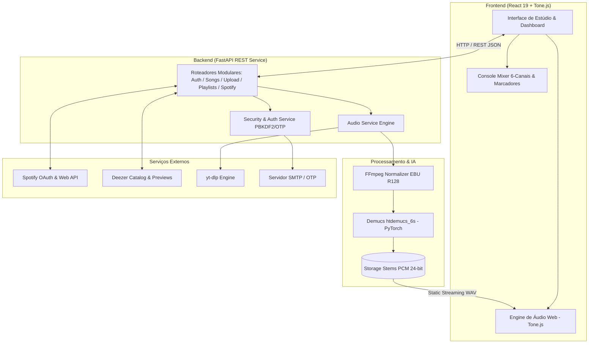

# 🎧 EasyCovers — AI-Powered Audio Demixing & Studio Practice Workstation

<div align="center">


<p align="center">
  <b>Plataforma Full-Stack de separação de faixas musicais com Inteligência Artificial e estúdio de prática multipista para músicos.</b>
</p>

[Visão Geral](#-o-problema-e-a-solução) •
[Diferenciais de Engenharia](#-diferenciais-técnicos--engenharia) •
[Arquitetura](#-arquitetura-do-sistema) •
[Tecnologias](#-tecnologias-utilizadas) •
[Como Executar](#-como-executar-o-projeto) •
[Testes](#-testes-automatizados)

</div>

---

## 🎯 O Problema e a Solução

### 🔴 O Problema
Músicos, cantores, bandas e produtores frequentemente enfrentam barreiras para estudar e criar repertório:
- **Backing tracks limitadas ou inexistentes:** A maioria das músicas não possui faixas isoladas (stems) disponíveis comercialmente.
- **Dificuldade de isolamento:** Tirar um solo de guitarra, uma linha de contrabaixo ou passagens rápidas de bateria em mixagens densas é um desafio de percepção auditiva.
- **Ferramentas genéricas e caras:** Softwares de estúdio (DAWs) têm curvas de aprendizado íngremes e não oferecem integração direta com fontes modernas de streaming e vídeo.

### 🟢 A Solução: EasyCovers
O **EasyCovers** é uma solução completa (Full-Stack) que democratiza o acesso a faixas isoladas de alta fidelidade:
1. **Entrada flexível:** O usuário pode fazer upload de áudios próprios ou buscar faixas diretamente integradas via YouTube, Spotify e catálogo Deezer.
2. **Separação por Redes Neurais (IA):** O backend decompõe o arquivo em até **6 faixas isoladas** (*Vocais, Bateria, Baixo, Guitarra, Piano e Outros*).
3. **Mixer de Estúdio no Navegador:** Um console interativo em Web Audio API permite controlar volumes individuais, mutar instrumentos específicos (para tocar junto) ou deixá-los em solo (para tirar detalhes da execução).
4. **Marcadores de Treino (Looping A/B):** Ferramenta dedicada para marcar seções específicas (ex: "Solo", "Refrão", "Intro") e praticar em repetição contínua.

---

## ⚡ Diferenciais Técnicos & Engenharia

O projeto foi construído priorizando **qualidade de áudio de estúdio**, **segurança**, **performance** e **design modular**:

### 1. Pipeline de Áudio Hi-Fi (24-bit PCM & LUFS)
- **Normalização EBU R128:** Pré-processamento com filtro `loudnorm` (-14 LUFS, True Peak -1.0 dBFS) e resampler sinc de alta precisão (64 taps) via FFmpeg.
- **Separação com Demucs (`htdemucs_6s`):** Rede neural profunda da Meta AI para separação de fontes musicais carregada via *Lazy Loading* com detecção automática de aceleração GPU (CUDA) ou CPU.
- **Inversão e Anti-Clipping:** Desnormalização estatística precisa com algoritmo proprietário de teto dinâmico (`PEAK_CEILING = -0.01 dBFS`), garantindo zero distorção digital e preservação da coerência espectral entre stems.
- **Exportação PCM 24-bit:** Áudios salvos com 144 dB de faixa dinâmica, evitando o truncamento e artefatos de quantização comuns em 16-bit.

### 2. Mixer Web Audio de Baixa Latência (Frontend)
- Desenvolvido sobre **Tone.js** e a **Web Audio API** nativa do navegador.
- Sincronização de play/pause entre múltiplos buffers de áudio simultâneos com drift nulo.
- Sliders analógicos táteis com feedback visual de VU meters, ganho logarítmico e estados de *Solo* e *Mute* por canal.

### 3. Segurança & Autenticação de Produção
- **Hashing de Senhas Criptográfico:** Implementação com `PBKDF2-HMAC-SHA256` utilizando salt aleatório criptográfico (100.000 iterações), em conformidade com OWASP.
- **Fluxo de Ativação por OTP:** Envio assíncrono de código de verificação de 6 dígitos via SMTP (com fallback para modo simulador em ambiente de desenvolvimento local).
- **Proteção contra Injeção de E-mail (CWE-93):** Sanitização estrita de quebras de linha (`\r\n\0`) em cabeçalhos de e-mail.
- **Proteção Anti-Enumeração (CWE-208):** Respostas padronizadas com timing constante para evitar descoberta de contas existentes.
- **Defesa Pre-Account Takeover (CWE-287):** Re-cadastros preservam credenciais pendentes até a validação definitiva da posse do e-mail.
- **Rate Limiting:** Bloqueio progressivo de tentativas e cooldown de reenvio.

### 4. Integrações de APIs & Ecossistema
- **Spotify Web API (OAuth 2.0):** Sincronização de playlists do usuário, faixas curtidas e resolução inteligente de capas com cache em disco e detecção de fallbacks.
- **Deezer API:** Pesquisa global em tempo real de metadados, capas em altíssima resolução e streaming de previews de 30 segundos.
- **LRCLIB:** Integração para recuperação de letras sincronizadas linha por linha com a reprodução musical.
- **yt-dlp:** Extração de fluxo de áudio lossless com argumentos anti-queda de CDN e rotação de cliente.

---

## 🏛 Arquitetura do Sistema



---

## 💻 Tecnologias Utilizadas

| Camada | Tecnologias / Bibliotecas | Finalidade |
| :--- | :--- | :--- |
| **Backend** | Python 3.10+, FastAPI, Uvicorn, SQLAlchemy | API REST de alto desempenho, injeção de dependências e ORM |
| **Inteligência Artificial** | PyTorch, Demucs (`htdemucs_6s`), NumPy | Redes neurais para separação musical em 6 stems |
| **Processamento de Áudio** | FFmpeg, SoundFile, torchaudio | Normalização LUFS, resample sinc e exportação 24-bit |
| **Frontend** | React 19, Vite, Tailwind CSS v4 | SPA reativa, design system de estúdio e tempo de build ultrarrápido |
| **Engine de Áudio Web** | Tone.js, Web Audio API | Mixagem de áudio multipista, roteamento de nós e baixa latência |
| **Banco de Dados** | SQLite (dev) / Suporte a PostgreSQL | Persistência relacional de usuários, playlists, marcadores e músicas |
| **Segurança & Rede** | Google OAuth, PBKDF2-SHA256, Requests, Dotenv | Autenticação, controle de sessões e parametrização de ambiente |
| **Testes Automatizados** | Python `unittest`, Mock, Pytest | Suíte com 20 testes cobrindo áudio, segurança e regras de negócio |

---

## 📁 Estrutura do Projeto

```text
easyCovers/
├── back/                         # Backend (FastAPI + PyTorch + Demucs)
│   ├── app/
│   │   ├── main.py               # Ponto de entrada da aplicação e middlewares
│   │   ├── database.py           # Conexão SQLite/SQLAlchemy e migrações dinâmicas
│   │   ├── models.py             # Modelos relacionais (User, Song, Playlist, etc.)
│   │   ├── schemas.py            # Schemas de validação de dados (Pydantic)
│   │   ├── routers/              # Rotas modulares desacopladas
│   │   │   ├── auth.py           # Autenticação, login, registro e verificação
│   │   │   ├── songs.py          # Gerenciamento de músicas e marcadores de treino
│   │   │   ├── upload.py         # Upload local e ingestão via YouTube
│   │   │   ├── playlists.py      # CRUD de playlists e vinculação de faixas
│   │   │   ├── spotify.py        # Integração OAuth 2.0 e busca no Spotify
│   │   │   ├── music.py          # Busca Deezer e integração com letras LRCLIB
│   │   │   ├── profile.py        # Perfil do músico, bio e mídias sociais
│   │   │   └── landing.py        # Endpoints públicos para landing page
│   │   └── services/
│   │       ├── audio_service.py  # Pipeline Demucs, normalização e anti-clipping
│   │       └── email_service.py  # Envio seguro de e-mails e gestão de OTP
│   ├── tests/                    # Suíte completa de testes automatizados
│   │   ├── test_audio_quality.py # Testes de matemática de áudio e 24-bit
│   │   ├── test_email_verification.py # Testes de segurança, rate limit e OTP
│   │   ├── test_playlists.py     # Testes de ciclo de vida de playlists
│   │   └── test_practice_markers.py # Testes de persistência de marcadores
│   ├── requirements.txt          # Dependências Python documentadas
│   └── .env.example              # Guia para configuração de variáveis de ambiente
│
├── front/                        # Frontend (React 19 + Vite + Tailwind CSS)
│   ├── src/
│   │   ├── components/           # Componentes modulares de estúdio
│   │   │   ├── StudioChannelStrip.jsx    # Canal individual do mixer (fader, solo, mute)
│   │   │   ├── MixerMasterRack.jsx       # Rack de masterização e controles globais
│   │   │   ├── LandingInteractiveMixer.jsx # Mixer interativo para demonstração
│   │   │   └── SpotifyHubSection.jsx     # Hub integrado para playlists do Spotify
│   │   ├── pages/                # Páginas da aplicação (Dashboard, Mixer, Upload...)
│   │   ├── utils/
│   │   │   └── studioAudioEngine.js      # Integração com Web Audio API / Tone.js
│   │   └── App.jsx               # Roteamento e layout base
│   ├── package.json              # Metadados e dependências frontend
│   └── vite.config.js            # Configuração do bundler Vite
│
├── rodar_projeto.bat             # Script de inicialização integrada para Windows
└── README.md                     # Documentação completa para recrutadores e desenvolvedores
```

---

## 🚀 Como Executar o Projeto

### Pré-requisitos
- **Python 3.10 ou superior**
- **Node.js 18 ou superior**
- **FFmpeg** instalado e configurado nas variáveis de ambiente (`PATH`) do sistema

### 1. Clonando o Repositório
```bash
git clone https://github.com/Lucas-Abbade/easyCovers.git
cd easyCovers
```

### 2. Configurando o Backend
```bash
# 1. Acesse o diretório do backend
cd back

# 2. Crie e ative um ambiente virtual
python -m venv venv
# No Windows:
venv\Scripts\activate
# No Linux/Mac:
source venv/bin/activate

# 3. Instale as dependências
pip install -r requirements.txt

# 4. Configure o arquivo de variáveis de ambiente
cp .env.example .env

# 5. Inicie o servidor FastAPI
python -m uvicorn app.main:app --reload --port 8000
```
> O backend estará acessível na porta `8000`. A documentação interativa da API (Swagger UI) pode ser visualizada em: `http://localhost:8000/docs`.

### 3. Configurando o Frontend
Abra um novo terminal:
```bash
# 1. Acesse o diretório do frontend
cd front

# 2. Instale os pacotes npm
npm install

# 3. Inicie o servidor de desenvolvimento
npm run dev
```
> A aplicação web estará disponível em `http://localhost:5173`.

---

## 🧪 Testes Automatizados

A aplicação conta com uma suíte de testes unitários que valida a integridade dos algoritmos de áudio, segurança criptográfica e regras de negócio:

Para executar todos os testes do backend:
```bash
cd back
python -m unittest discover -s tests
```

**Resultado esperado:**
```text
Ran 20 tests in 0.48s
OK
```

### O que os testes cobrem:
- **`test_audio_quality.py`:** Normalização estatística de entrada do Demucs, inversão exata sem perda, quantização 24-bit vs 16-bit, prevenção de clipping e opções robustas do yt-dlp.
- **`test_email_verification.py`:** Geração e hashing de OTP SHA-256 com salt, proteção contra força bruta (bloqueio após 5 tentativas), expiração temporal, cooldown de reenvio (HTTP 429), prevenção de enumeração de contas (CWE-208) e rate limiting horário.
- **`test_playlists.py`:** Associação de faixas, prevenção de duplicatas, atualização e exclusão em cascata.
- **`test_practice_markers.py`:** Criação, persistência e recuperação de trechos marcados para estudo (looping).

---

## 👨‍💻 Autor

Desenvolvido por **Lucas Abbade**  
- **GitHub:** [github.com/Lucas-Abbade](https://github.com/Lucas-Abbade)  
- **LinkedIn:** [Seu LinkedIn](https://www.linkedin.com)  
- **E-mail:** [lucasabbade1@gmail.com](mailto:lucasabbade1@gmail.com)
